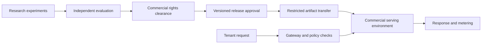

# Tafsiri Cloud commercial architecture 001

Integration note: this document retains the foundational commercial boundary. The [Cloud technical architecture](tafsiri-cloud-technical-architecture-001.md) and [release lifecycle](tafsiri-model-release-and-commercial-handoff-001.md) complete its technical contracts within the [platform reference architecture](tafsiri-platform-reference-architecture-001.md). All Cloud services remain planned.

Date: 2026-11-19. Status: future-facing architecture and interface contracts only. No public translation API, serving model, billing integration, tenant or deployment is implemented by this work.

## Boundary and topology

The commercial environment has separate credentials, deployment roles, tenant data, storage and retention policies. It cannot query privileged research/source/reviewer databases and holds no research service-role key. A release publisher transfers approved artifacts plus a minimal manifest; the receiving service verifies digest, approval, rights scope and revocation state. No live foreign-server link or request-time research-table lookup is permitted.

## Components and contracts

| Component | Proposed responsibility and boundary |
|---|---|
| API gateway | TLS endpoint, authenticated request ID, schema/input-size validation, tenant policy and version selection; no research authority |
| Language/variety catalog | Public projection of approved service capabilities, exact identity keys, supported directions/orthographies and model versions; never equate registry membership with translation support |
| Serving/routing interface | Resolve exact requested scope to an approved immutable model artifact; no fallback to a neighboring variety or generic Luhya |
| Tenant authentication/isolation | Tenant-bound principal and scopes at every query/job/storage boundary; separate operator authority; verify object ownership even for UUID paths |
| API key management | Server-generated secrets shown once, stored as secure hashes, scoped and expiring, rotation/revocation and audit; never record raw keys in logs |
| Usage metering | Append-only tenant/request/version/unit events with idempotency; record success/failure/retry semantics before billing |
| Quotas/rate limits | Enforce tenant/key budget and concurrency limits before expensive work; distributed counters when justified; retry guidance on denial |
| Billing boundary | Provider-neutral account/subscription and metered-usage interface; signed webhook verification and deduplication when later implemented; no payments now |
| Enterprise configuration | Allowed directions/models, retention/region requirements, access roles and release pinning; customer settings cannot override rights or linguistic scope |
| Translation history | Off by default; explicit opt-in, tenant ownership, declared retention, deletion/export and backup expiry; private text excluded from normal logs |
| Commercial rights verifier | Require current commercial clearance of all dependencies and model licenses for the intended service/territory/use; reject unknown or revoked rights |
| Monitoring/feedback | Availability/latency/errors, quality by declared scope and drift; minimal text-free telemetry; consented feedback enters existing governed intake |
| Deployment/rollback | Signed/versioned manifest, staged validation, approved rollout, pinned old version and kill switch; rollback only to a still-cleared approved artifact |

## Release-state distinctions

| State | Meaning | Eligible for public serving? |
|---|---|---|
| Experimental research model | A recorded experiment, possibly unevaluated | No |
| Evaluated model candidate | Meets the specified research evaluation, with limitations | No |
| Commercially cleared model | Dataset/model licenses and intended commercial use explicitly cleared | No; operational release still required |
| Production-approved service | Exact model/version/directions approved for serving after quality, security, rights and operations checks | Only within that approved scope |

Approvals bind immutable model/dataset digests, scope, policy versions, approvers, timestamps and expiry/revocation information. Updating model bytes invalidates the old approval. Research administrators, rights approvers and release operators have separate responsibilities; one broad role must not silently confer all three.

## Proposed interface shapes

These are documentation contracts; no routes exist as a result of this design.

`ReleaseManifest v1`: release ID; model artifact SHA-256; model/run version; dataset manifest hashes; base-model license reference; exact source/target language and variety keys; orthography versions; evaluation report hash; commercial clearance reference/validity; production approval reference; revocation identifier; intended-use restrictions. Include no source text, private reviewer identities or privileged artifact URLs.

`TranslationRequest v1`: tenant derived from verified credential; client idempotency key; source and target scope keys; text; optional approved model version; allowed retention preference. Tenant IDs in bodies are never authoritative. Missing or ambiguous variety selection returns a validation error rather than guessing. Automatic language identification, if introduced, needs its own evaluated capability and explicit uncertainty response.

`TranslationResponse v1`: request ID; exact selected scope and model/release version; outcome (`translated`, `unsupported_scope`, `uncertain`, `unavailable`); text only when approved behavior supports it; bounded explanation for uncertainty or preserved terminology. No invented confidence or quality score. If no established equivalent is known, preserve-and-explain behavior itself must be validated in the requested variety; otherwise return uncertainty rather than fabricate an explanation.

`UsageEvent v1`: event ID, tenant ID, request ID, model version, declared unit/count, outcome, timestamp and deduplication key. Metering policy specifies whether failures/retries count; provider outages must not duplicate charges. Future billing receives these events, not private source text.

`FeedbackSubmission v1`: request/model reference, explicit consent/use choice and user observations. Feedback remains unverified and enters the existing evidence workflow; service output never becomes approved training data automatically.

## Rights and operational controls

`MODEL_TRAINING=ALLOWED` does not establish `COMMERCIAL_API=ALLOWED`; public display, redistribution and benchmark publication also remain separate. A release must assess all contributing assets, base model licenses, consent restrictions and approved derivative use, not just the final checkpoint. Missing decisions block release. No legal clearance is presumed from an architecture document.

Use private artifact transfer, integrity checks, short-lived operator access and audit logs. Rights revocation/quality incidents can disable a release immediately. Rollback cannot restore a model whose rights were withdrawn. Define and rehearse incident response, key rotation, tenant isolation and restore procedures before service launch. Avoid caching private request/response text across tenants; catalog caching may contain public capability metadata only.

## Future acceptance tests and prerequisites

Tenant A cannot read Tenant B's histories, jobs, keys or usage. Revoked keys and manipulated tenant IDs fail. Unsupported variety requests never route to another variety. Research-only or altered-digest model artifacts cannot deploy. Expired commercial permission blocks release and serving as required by policy. Duplicate usage/webhook events remain idempotent. Retention-off requests leave no translation text in history/logs. Feedback without training consent remains ineligible for training. Rollback to a revoked version fails; rollback to a cleared version preserves request/version traceability.

All are future test requirements. Launch depends on validated models/datasets, commercial rights, an approved security/privacy design, operational tests and explicit deployment authorization. No provider selection or customer provisioning is needed for this architecture milestone.
