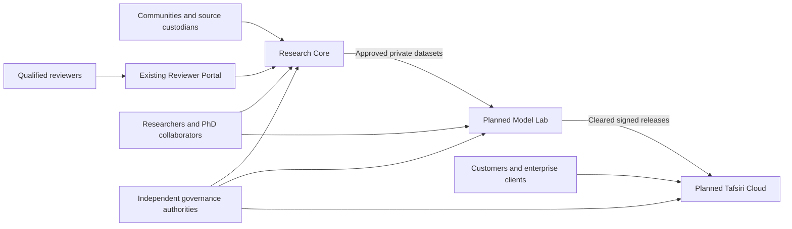
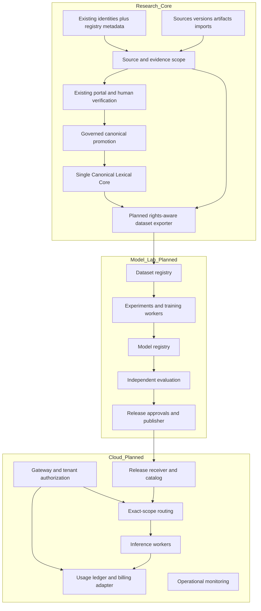
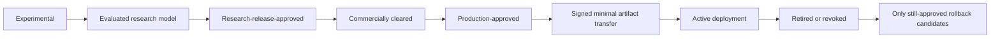

# Tafsiri platform reference architecture 001

Status: architecture for review, 2026-11-20 UTC. This is the authoritative integration blueprint; it does not authorize deployment, data access or model use. Luhya is the reference implementation of a multilingual African-language platform. Lutsotso, Bukusu, Luwanga, Maragoli and Isukha remain independently scoped varieties.

## Authority and inspected baseline

The [multilingual amendment](../research/multilingual-architecture-amendment-001.md) and [seven ADRs](decisions/adr-multilingual-001-single-pipeline.md) retain their decisions. Detailed implemented contracts in the 011/012/013 reports govern existing code; this series governs future integration. Historical audits describe their inspection dates, not today's implementation state. In particular, 013 implements REGISTERED/RESEARCH_ENABLED/SUSPENDED/RETIRED, replacing the amendment's conceptual pre-registration lifecycle. No proposed HTTP contract replaces its SQL interface.

Repository base: `e939479ad6a63ef9ad628f26e92fc9dd0ff43461`. GitHub inspection confirmed PRs #22–#26 OPEN. #22 and #23 target staging; #24 targets #23's branch, #25 targets #24, #26 targets #25. This architecture stacks on #26, `feature/tafsiri-multilingual-platform-foundation`. Integration must account for #22 already being present in #23's history; do not blindly merge every branch twice.

| Component | Evidence and current status | Remaining boundary |
|---|---|---|
| Sources, artifacts, imports, evidence, canonical rules | Existing foundation through logical 010; deployed status documented in [technical architecture](../technical_architecture.md) | Historical hosted observations, not a new live health check |
| Reviewer Portal and legacy candidate runner | Existing application/workflows and frozen HE001/Pipeline 001 | No multilingual qualification gateway yet |
| Canonical Lexical Core | [011 implementation](../research/migration-011-implementation-report-001.md), PR #23, implemented/unmerged and not hosted | Empty foundation, no automatic legacy conversion |
| Lexical promotion | [012 governance](../research/canonical-lexical-promotion-architecture-001.md), PR #24, implemented/unmerged and not hosted | Individual principals and exact authorities require separate provisioning |
| Luwanga lexical pilot | PR #25 preparation documents | No real lexical promotion; provenance, rights and qualifications blocked |
| Registry/profile pipeline | [013 foundation](../research/multilingual-platform-foundation-001.md), PR #26, implemented/unmerged and not hosted | Synthetic profile CLI only; no private real-data exporter |
| Dataset preparation, Model Lab, release publisher, Cloud | Planned in this series | No working training, billing, public translation or serving service |

## System context

## Component ownership

Research owns original provenance, evidence, canonical decisions and export authorization. Model Lab owns derived dataset/run/model metadata and project access. It receives approved snapshots, not research database credentials. Cloud owns tenants, service catalog projections, usage, subscriptions and deployment state. It has no privileged research DB connection, research service-role key, source URL or reviewer identity. Platform identity federation may identify people across applications; it never transfers authorization between these domains.

## Research-to-model flow

```mermaid
flowchart LR
  P[Source lineage and preserved machine origin] --> H[Human evidence verification]
  H --> C[Separate canonical decision]
  C --> E[Private exporter checks intended-use rights]
  E --> S[Immutable splits and leakage report]
  S --> A[Dataset approval and manifest digest]
  A --> J[Project-authorized training job]
  J --> T[Checkpoint and experiment result]
  T --> V[Independent held-out evaluation]
```

Canonical examples require approved canonical revisions. Other research tasks may use separately approved source/evidence-only datasets under an explicit protocol, preserving their noncanonical status; no exporter can label them canonical. Every included item requires complete lineage, applicable human decisions, training permission and consent. A digest proves byte integrity, not truth or permission. Permissions are rechecked at export, run admission and release, with revocation checked during long runs.

## Model-to-commercial flow

These arrows require explicit decisions, not automatic state progression. Denials preserve history. Commercial eligibility is the intersection of current rights, evaluation scope, production approval and tenant/region policy. The catalog cannot turn registry membership or family relationships into capability claims. Customer feedback returns only through consented governed intake; model output never automatically becomes verified training data.

## Blueprint navigation

| Design | Authority |
|---|---|
| Existing portal extension | [Reviewer architecture](tafsiri-multilingual-reviewer-architecture-001.md) |
| Training and research collaboration | [Model Lab](tafsiri-model-lab-technical-architecture-001.md) |
| SaaS and inference | [Cloud](tafsiri-cloud-technical-architecture-001.md) |
| Approval and transfer | [Release lifecycle](tafsiri-model-release-and-commercial-handoff-001.md) |
| Hosting and operations | [Infrastructure](tafsiri-infrastructure-architecture-001.md) |
| Trust and governance | [Security](tafsiri-platform-security-architecture-001.md) |
| Interoperability | [Contract catalog](tafsiri-api-and-data-contracts-001.md) |
| Delivery gates | [Roadmap](tafsiri-platform-implementation-roadmap-001.md) |
| Reconciliation and open decisions | [Consistency review](tafsiri-architecture-consistency-review-001.md) |
