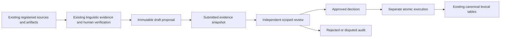

# Canonical lexical promotion and research governance 001

Status: implementation for independent review; no hosted deployment or real-data promotion authorized.

## Dependency and existing architecture

The implementation branch is `feature/tafsiri-canonical-lexical-promotion`, based on PR [#23](https://github.com/Global-Data-Science-Institute/project-tafsiri/pull/23), commit `b700283b03937185c091bad7edf3d22183660e09`. Both [#22](https://github.com/Global-Data-Science-Institute/project-tafsiri/pull/22) and #23 were open and unmerged at the readiness check. Integration order is #22, #23, then this change. The new draft PR targets #23's branch so its diff contains only promotion work. No dependency is merged automatically.

Migration 009 already provides `contributor_roles`, `contributor_role_types`, immutable linguistic rule revisions and rule-specific promotion/output structures. Those promotion tables require rule IDs and rule actions; using them for lexical claims would weaken their contracts. This implementation reuses the contributor roles and creates only the lexical governance structures that those rule tables cannot represent.

Source registration, artifact hashes, import batches, source entries, source-use policies, linguistic evidence and human verification remain the existing pipeline. Candidate generation continues to produce proposals; its historical outputs and frozen evaluation files are unchanged. Portal authorization uses Supabase Auth and its existing research-admin checks; it does not establish canonical approval authority or a database researcher identity.

Migration 011's thirteen canonical tables remain the sole lexical foundation. No duplicate dictionary, ingestion engine, candidate engine, source database or portal is introduced. New versioned migration:

[`20261120005801_create_canonical_lexical_promotion_governance.sql`](../../supabase/migrations/20261120005801_create_canonical_lexical_promotion_governance.sql), generated with the installed project Supabase CLI 2.114.0.

## Objects and security boundary

Five private tables live in the non-exposed `lexical_governance` schema:

| Table | Contract |
|---|---|
| `principals` | Individual database login to existing contributor identity; immutable except one-way revocation |
| `authorities` | Existing canonical-approver role with frozen contributor/role identity, exact language XOR dialect scope, permitted operation keys, competence reference, finite validity, owner-issued grant and one-way revocation |
| `proposals` | Stable UUID, unique idempotency key, proposal/policy versions, operation/evidence manifest, requester, frozen snapshot/digest, lifecycle and approval/execution attribution |
| `events` | Append-only decisions, assessments, selected authority evidence, failures, timestamps and actual login |
| `outputs` | Ordered operation, existing canonical table/UUID, and before/after records |

All five have RLS and no client policies. PUBLIC, anon, authenticated, service_role and the researcher group have no direct table or sequence privileges. Only two entry functions are granted to the new inert `tafsiri_lexical_researcher` NOLOGIN group: `create_proposal(jsonb)` and `command(uuid,text,jsonb)`. Nine private helper/trigger functions and one public invoker-only concept guard complete the implementation. All functions have an empty search path, qualified relation references and explicit EXECUTE revocations.

The two entry functions deliberately use SECURITY DEFINER to perform narrowly allowlisted writes. They identify the caller through PostgreSQL `session_user`, bound to a private principal. They do not accept an actor UUID, trust JWT user metadata, use `auth.uid()` to impersonate a database login, or trust caller-controlled session settings. PostgREST's authenticator and service role are excluded principals. Authentication uses a separately provisioned individual libpq login; the normal portal and service key cannot call this interface.

An independent database operator must provision each real login, group membership, principal binding, existing `CANONICAL_APPROVER` contributor role and qualification after checking the human evidence. No real accounts, qualifications or authority are seeded. Login credentials must be individual, revocable and protected with the deployment's TLS/access controls. Do not use a shared owner/service login or repurpose a dropped login name without revoking its old principal. The qualified approver must differ from the proposer. The role must be active, unrevoked, currently valid, and have a compatible dialect/domain; the qualification must independently match the exact scope and each `action:table` key. A dialect's parent language never grants language-wide authority. Neither self-reported expertise nor portal membership grants these privileges.

Migration 012 revokes service-role INSERT/UPDATE on all thirteen canonical tables. Their service-role SELECT privilege remains. A new trigger blocks client/service adoption or alteration of canonical metadata on legacy `concepts`; existing legacy fields and grants remain. No private review narrative is written to that publicly readable table. `form_normalizations` and `concept_revisions` are protected but have no promotion operation in policy 001. Creating/revising global concepts and normalization policies requires a separate reviewed extension. Existing concepts can be mapped to a sense without changing the concept.

Each qualification captures its contributor and the original contributor-role row at issuance. Changing a legacy role's contributor, type, dialect or domain cannot transfer or expand that qualification. Both the original and current role-validity windows are enforced; extending the legacy row cannot extend the approved original window. Revoking either the role or private qualification blocks use. This is necessary because legacy contributor roles remain service-editable for the existing rule workflow.

Database owners and superusers remain able to change code, grants or disable triggers. The functions are migration-owner controlled. This cannot protect against a compromised database administrator. Existing source/evidence registrars remain trusted to maintain their own permission and provenance records; they cannot approve a lexical proposal through these functions.

## Workflow and research decisions



The normal lifecycle is DRAFT → SUBMITTED → UNDER_REVIEW → APPROVED → EXECUTED. The proposer can withdraw before execution. An independent qualified approver can reject SUBMITTED/UNDER_REVIEW proposals, dispute UNDER_REVIEW/APPROVED/EXECUTED proposals, and record reasons. These transitions are also enforced by a database trigger. Terminal proposals cannot be edited or resubmitted; corrections use a new UUID/idempotency key and a higher proposal version. Draft manifests are immutable too, eliminating mutable drafts that invalidate an unnoticed review.

Submission validates evidence and freezes a SHA-256 digest over the policy, entire manifest and registered evidence snapshot. Review and approval are separate calls. Approval requires the exact digest, explicit confirmation of source fidelity, a scope assessment and a contradiction assessment. Faithfully transcribing a source does not establish linguistic truth: that additional judgment is the qualified independent approver's recorded decision. Approval rehearses every operation but rolls back that rehearsal. It creates no canonical records.

Execution is another explicit call by the proposer or a currently qualified independent approver. It revalidates evidence, rights, current authority and the original authorization snapshot before writing. An executed proposal may subsequently be disputed without deleting its original decision or outputs. Disputing a proposal's decision does not silently rewrite its canonical outputs: a separately approved DISPUTE proposal can mark the referenced lexical claim disputed while preserving its seal and prior attribution.

## Proposal and operation contract

The JSON manifest contains `id`, `idempotency_key`, `proposal_type` (CREATE/REVISE/ASSERT/DISPUTE), positive `proposal_version`, fixed `policy_version=LEXICAL_PROMOTION_001`, exactly one `language_id`/`dialect_id`, `provenance_origin`, a `contradiction_statement`, ordered `operations`, and `evidence`. Language proposals additionally require `language_scope_rationale`. Proposal type describes the research request; actual permissions are checked for every operation.

Each evidence item names existing `source_entry_id`, `evidence_id`, `artifact_id`, and a role: SUPPORTS, CONTRADICTS, QUALIFIES or HISTORICAL_SUPPORT. Each operation names `table`, `action`, and a `data` object with an explicit stable UUID. Parent records must precede child inserts. No spelling lookup, lexical identity merge, vocabulary generation or inferred translation is performed.

| Action | Supported existing tables |
|---|---|
| `insert` | lexemes, lexeme_forms, lexical_senses, lexical_sense_revisions, lexeme_dialects, sense_dialects, sense_concepts, lexical_relationships, form_relationships, lexical_attestations, lexical_linguistic_evidence |
| `set_current` | lexemes.current_lemma_form_id, lexical_senses.current_revision_id |
| `dispute` | lexemes, lexical_senses, sense_concepts |

`set_current` requires `expected` with the exact old pointer, including explicit JSON null for a new parent. `dispute` requires the expected old verification/mapping status. Semantic updates, deletion, identity merging, replacement/supersession graph editing and arbitrary SQL are not operations. New meanings are new immutable revisions. The executor supplies verification, seal attribution, provenance and timestamps; caller-supplied managed fields are rejected. Existing 011 constraints/triggers remain active. Current lemmas must be verified lemma forms; current meaning revisions must be verified. Ordinary additions require a current verified lexical parent, while attestations can preserve evidence about disputed claims.

Every inserted lexeme, form, meaning revision, concept mapping or relationship needs a supporting claim-level attestation in the same proposal. Every disclosed source, including contrary evidence, must remain linked by an attestation. Explicit linguistic-evidence associations can only use the reviewed evidence set. Dialect assertions cannot expand beyond the proposal's exact variety. Both ends of a lexical/form relationship must have that same exact scope. Cross-scope borrowing/cognate relations require a future multi-scope approval contract; this first workflow fails closed. Historical forms, established borrowed forms and preserved original technical terms can be represented without inventing native vocabulary. Their authenticity still requires human research approval.

## Evidence and rights validation

Validation and the digest cover registered source/version, import batch, unchanged source entry, evidence, artifact, artifact links, dialect mappings, source variety mentions, evidence dialect links, relevant evidence relations, current rights and both required research-use policies.

The following must hold:

1. All IDs resolve. Entry and evidence belong to the same registered source version and exact locator. The import batch checksum/algorithm matches the registered, non-quarantined artifact, which is linked to that version. This verifies registered lineage; it does not redownload bytes or independently authenticate a source.
2. Supporting/historical evidence is currently human VERIFIED, attributed and not superseded. Contrary evidence remains available even when disputed. Known CONTRADICTS/ALTERNATIVE_TO neighbors must be included; opposite evidence to a supporting claim must be explicitly classified as contrary/qualifying. The human assessment must explain how it was considered. The system cannot discover contradictions absent from the research database.
3. Exactly one current rights record is usable, in OPEN_LICENSE/PUBLIC_DOMAIN/PERMISSION_GRANTED status and within its dates. Both INTERNAL_RESEARCH and HUMAN_REVIEW policies must explicitly allow the operation now. Unknown, cited-only, expired, missing or ambiguous rights fail closed. MODEL_TRAINING and COMMERCIAL_API decisions are neither inferred nor changed.
4. Variety proposals require compatible primary dialect evidence plus an unambiguous, current, verified existing mapping of the entry's literal source label. An unresolved label cannot become a canonical variety through this workflow. Language proposals require independent exact-language authority and an explicit language assessment; a source entry carrying an unresolved variety label cannot be promoted at language scope. The legacy evidence schema has no language-ID column; language scope therefore remains an explicit qualified human decision, never an inference from a dialect's classification.
5. All canonical foreign keys, owner pointers, immutable seals, uniqueness and expected current state hold. Rehearsal and execution call the same operation engine. Changed reviewed evidence requires a fresh proposal/review; it is not silently rehashed at execution.

## Transactions, idempotency and audit

All coordinated operations, outputs and EXECUTED transition commit together. A failed required operation rolls back the entire execution block, including any prior inserts. The function then returns `{ok:false,...}` and appends a private failure event. The CLI commits that structured failure response so the event persists, and exits nonzero. If the client rolls back its outer transaction, disconnects before commit or the database aborts the transaction, that event cannot survive; infrastructure/database logs are needed for those failures and for requests denied before a proposal/actor is established. No claim of autonomous audit transactions is made.

Unique idempotency keys bind exact immutable request content and proposer. Identical create retries return the same proposal; changed content with the same key fails. Completed execution retries return the original output references even after a later dispute. A transaction advisory lock serializes the first bounded pilot's promotions, and a proposal row lock protects state. SHARE locks on evidence, rights, classifications, principals and qualifications prevent concurrent changes, including newly inserted contrary evidence, through commit. READ COMMITTED is required; other isolation levels fail closed. Conflicting inserts fail atomically and stale expected pointers reject overwrites. Operators must retry ordinary deadlock/connection failures after inspecting the proposal; no automatic execution is introduced.

This conservative locking can delay source registration or authority maintenance. It is suitable for a bounded research pilot, not a high-volume serving API. Before scaling, benchmark and replace broad locks with a versioned input-locking protocol. Deferred constraint checks explicitly name only the trusted canonical constraints; caller-owned deferred triggers are never flushed inside the privileged function.

## Researcher interface and dry-run

[`scripts/lexical_promotion/promote.py`](../../scripts/lexical_promotion/promote.py) uses Python's standard library and `psql`. Connection credentials stay in libpq (`PGSERVICE`, `PGPASSFILE`, TLS configuration); the CLI never grants permissions, creates users, applies migrations or accepts an actor identity. This implementation/test session uses only disposable local databases. The commands below describe future operation after separate environment and pilot approval.

```sh
# With an individual, approved libpq profile already selected:
python scripts/lexical_promotion/promote.py --manifest proposal.json
python scripts/lexical_promotion/promote.py --action create --manifest proposal.json --commit
python scripts/lexical_promotion/promote.py --action submit --proposal UUID --commit
python scripts/lexical_promotion/promote.py --action inspect --proposal UUID
# The independent approver uses their own login:
python scripts/lexical_promotion/promote.py --action review --proposal UUID --commit
python scripts/lexical_promotion/promote.py --action approve --proposal UUID --decision decision.json --commit
# Approval is not execution:
python scripts/lexical_promotion/promote.py --proposal UUID
python scripts/lexical_promotion/promote.py --action execute --proposal UUID --commit
```

Dry-run is the default. It reports ordered create/revise actions and stable IDs, evidence links, digest, conflicts, missing approvals and executability. It rehearses real constraints in a rolled-back subtransaction. A manifest preview also rolls back its temporary draft and audit rows. No canonical or proposal records persist. Inspect also always rolls back. Database sequence gaps and transient locks are possible; there is no claim of a physically write-free database transaction. State-changing CLI actions require explicit `--commit`.

Use the synthetic [database fixture builder](../../tests/database/run_lexical_promotion_tests.py) as the executable contract example. Its tokens, definitions, qualifications and rights are invented software fixtures and must never be represented as authentic Luhya data.

## Review and next milestone

Read the [executed validation report](canonical-lexical-promotion-validation-001.md). Independent security/database review, dependency integration, fresh hosted drift/backup checks and explicit environment approval are still required before any deployment. Real-data promotion additionally requires approved rights, identified qualified reviewers/approvers, independent authority provisioning, a frozen evidence packet, a bounded pilot protocol and explicit per-proposal human decisions. Synthetic test success grants none of those permissions.

Reference checks: [PostgreSQL function security](https://www.postgresql.org/docs/17/sql-createfunction.html), [Supabase roles](https://supabase.com/docs/guides/database/postgres/roles), and [Supabase changelog](https://supabase.com/changelog.md). The installed project CLI remains 2.114.0; no CLI/framework upgrade was introduced.
