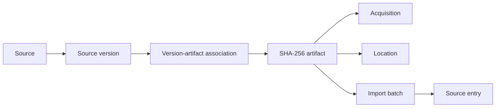

# Technical architecture

Project Tafsiri is a monorepo for dialect-aware research, source governance, human review, canonical knowledge, and future language technology. PostgreSQL/Supabase is the schema authority; applied migrations, constraints, policies, and grants define the deployed model.

For the current integrated blueprint and explicit deployed/unmerged/planned status, start with the [platform reference architecture](architecture/tafsiri-platform-reference-architecture-001.md). The component history below remains background; migrations 011–013 are implemented on the dependency branches but are not hosted, and Model Lab/Cloud remain planned.

## Architectural boundaries

The system separates source and rights governance, artifact and import lineage, located evidence, human review and canonical promotion, and derived datasets/models/runtime. No layer automatically promotes content into the next.

## Deployed migration sequence

| Migration | Deployed responsibility |
|---|---|
| Baseline | Legacy language tables, canonical concepts, candidate generation, evaluation, and reviewer workflows |
| 006 | Sources, versions, rights, use policies, contacts, import batches, and source entries |
| 007 | Linguistic evidence types, locators, notation, examples, dialect scope, relations, provenance, and verification |
| 008 | Scholarly book source-type support |
| 009 | Canonical linguistic rules, revisions, evidence links, dialect scope, promotions, outputs, and bounded authority |
| 010 | Source artifacts, acquisitions, locations, associations, sets, members, and artifact-aware import lineage |

The Canonical Lexical Core is the next deployment milestone. Migration 011's empty foundation is implemented and locally validated, with no staging or production deployment. The [implementation report](research/migration-011-implementation-report-001.md) records its reconciliation with the [multilingual SQL design review](research/migration-011-multilingual-sql-design-001.md). Read-only staging inspection during the architecture audit on 2026-11-19 confirmed migration history through 010; earlier production counts below are historical observations.

## Source and artifact lineage

This supports alternate binaries for one version, repeated receipt of identical bytes, multipart works, and reproducible parsing. Artifact identity is immutable; acquisitions and locations describe receipt and access without redefining it.

The Marlo registration is deployed in staging and production: 59 sources, 59 versions, 12 artifacts, 12 associations, 13 acquisitions, one set, five members, 59 current rights records, and 472 current use policies. The package has no import batches or source entries.

## Linguistic evidence and canonical rules

Located assertions retain source/version provenance, locators, extraction method, notation, dialect scope, review state, and reviewer attribution. Human verification confirms representation of a source; it does not create a canonical rule.

Canonical Promotion Pilot 001 produced four `PROVISIONAL` rules in staging and production. They have no runtime projection and are not executable serving behavior.

## Canonical Lexical Core

The next planned layer is `Lexeme → Form → Sense → Concept`. It will keep attestations separate from canonical objects and support homographs, polysemy, dialect and historical forms, variants, concepts, disputes, and explicit review state. Legacy dictionary and concept rows must not be relabeled as canonical lexical truth without governed migration and review.

## Reviewer Portal

`apps/reviewer-portal/` is a Next.js, React, and TypeScript research application using Supabase Auth, PostgreSQL, and Row-Level Security. It supports onboarding, participation, assignments, blinded review, deterministic resume behavior, withdrawal, and administrative controls. It is not a public translation runtime and does not directly promote annotations.

## Candidate generation and evaluation

`scripts/candidate_generation/` and `config/candidate_generation/` produce research proposals with provenance. `evaluation/` contains frozen packages, manifests, hashes, and pipeline snapshots that must not be rewritten during maintenance.

## Environments and deployment

Local, staging, and production use separate configuration and Supabase projects. The staging Vercel project serves the Reviewer Portal from `apps/reviewer-portal/`. Secrets belong in ignored environment files or hosting configuration.

Database changes are new versioned files under `supabase/migrations/`. Applied migrations are never rewritten, and existing tables are never dropped or destructively changed without explicit approval.

## Security model

- Browser clients use publishable credentials and Row-Level Security.
- Administrative operations use trusted server or CLI paths with environment guards.
- Privileged portal clients are server-only and require administrator authorization.
- Registration and promotion tools default to validation or dry-run and write atomically.
- Source receipt, review, or canonical status never grants client access automatically.

## Multilingual extension direction (2026-11-19)

The [architecture amendment](research/multilingual-architecture-amendment-001.md) reuses the existing `languages`, `dialects`, source/evidence structures and review pipeline. Proposed metadata adds evidence-backed classification, orthography and lifecycle without replacing identities or forcing every variety to have one uncontested parent. Lexical scope, definition language and normalization policy are explicit; identical strings do not imply equivalence.

The [seven ADRs](architecture/decisions/adr-multilingual-001-single-pipeline.md) record pipeline reuse, language/variety identity, dialect preservation, semantic relationships, reviewer authority, dataset/model governance and commercial separation. [Reviewer Portal design](research/multilingual-reviewer-portal-design-001.md) preserves existing HE001 access and blinded stages while specifying future scoped qualifications. No portal or database permissions change in this architecture phase.

The [Model Lab](research/tafsiri-model-lab-architecture-001.md) is the future experiment layer of the same pipeline. [Tafsiri Cloud](architecture/tafsiri-cloud-commercial-architecture-001.md) receives only cleared, versioned release artifacts through a separate operational boundary. It receives no privileged research database access. Both remain designs, not operational services.

## Technology and verification status

The [canonical lexical promotion implementation](research/canonical-lexical-promotion-architecture-001.md) extends the same source/evidence pipeline with private proposal, authority, audit and output records. Dedicated individual database logins and independent scoped approvals gate writes to Migration 011's canonical tables. A dry-run-first Python/psql interface reuses PostgreSQL constraints and irreversible seals; no new portal or training/serving path is added. Migration 012 is pending independent review and has not been deployed to a hosted database. Its [validation report](research/canonical-lexical-promotion-validation-001.md) records synthetic results and remaining pilot gates.

The repository uses PostgreSQL/Supabase, pgvector in the legacy knowledge schema, Next.js, React, TypeScript, Python, Supabase Auth, Row-Level Security, GitHub Actions, Vercel, and SHA-256 artifact addressing.

CI runs portal type checking, lint, tests, and build; Python regressions; a clean local Supabase migration reset; SQL smoke/security tests; atomic registration integration tests; and database lint. Governed operations additionally record dry-run plans, semantic digests, environment guards, idempotency, parity, advisors, and execution artifacts.
